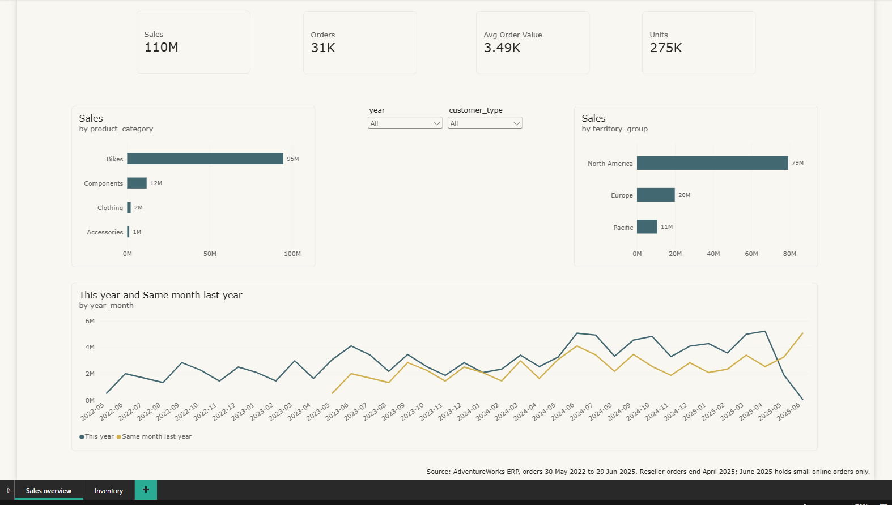
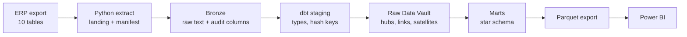
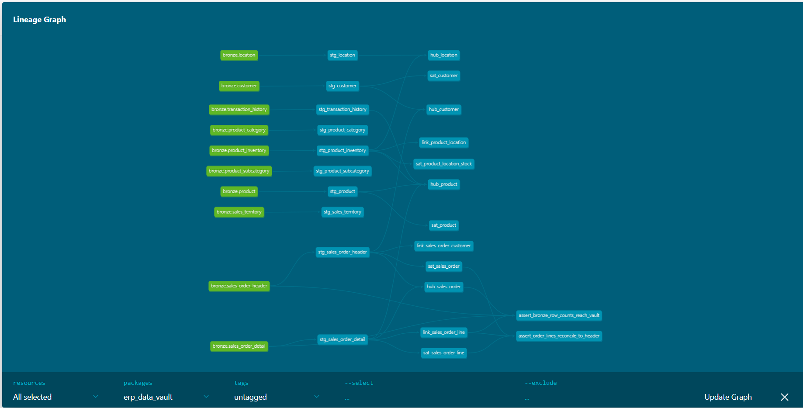
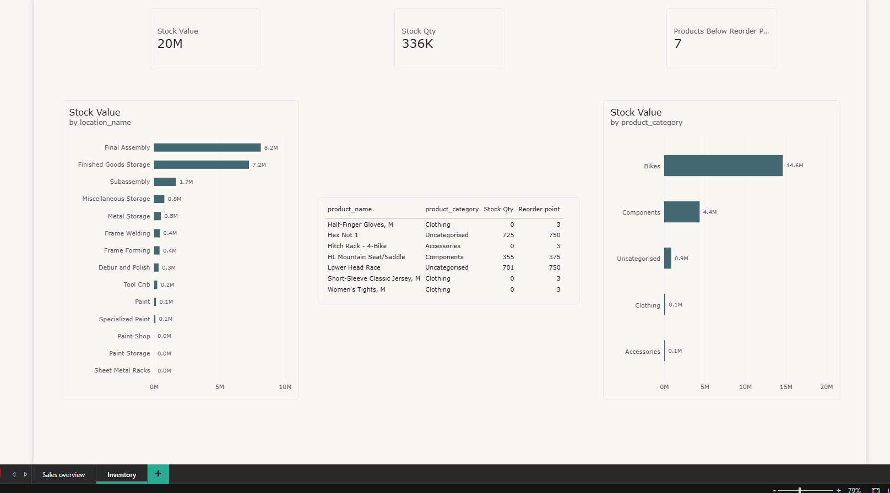

# ERP sales and inventory warehouse on Data Vault 2.0

[](https://github.com/AlyDk/erp-data-vault-dbt/actions/workflows/pipeline.yml)

A portfolio case study, delivered the way a data consultancy hands a warehouse over to a client.
It takes sales and inventory data from an ERP system, stores it with full history in a
Data Vault 2.0 model built in dbt, and serves a star schema to Power BI. A scheduled pipeline
rebuilds and tests everything every day.

**Live documentation and lineage:** https://alydk.github.io/erp-data-vault-dbt/



## The business problem

A distributor runs sales and stock in an ERP (Dynamics or SAP style). Reporting straight from the
ERP has three problems:

1. **No history.** The ERP keeps the current price, status and stock. Last quarter's values are gone.
2. **Fragile reports.** Every report re-implements the same joins and business rules.
3. **No trust.** Nobody can prove the report totals match the ERP.

This project solves all three: an insert-only Data Vault keeps every version of every record, one
star schema feeds all reports, and automated tests reconcile the warehouse to the source on every run.

## Architecture



| Layer | Tool | What happens |
|---|---|---|
| Extract | Python | Downloads the 10 ERP tables into `data/landing/<date>/` with a manifest (rows, bytes, SHA-256). |
| Bronze | Python + DuckDB | Loads every column as text, adds `_record_source`, `_source_file`, `_load_ts`. Fails if row counts differ from the manifest. |
| Staging | dbt views | Casts types, adds MD5 hash keys and hash diffs. |
| Raw Vault | dbt incremental | Insert-only hubs, links and satellites. A satellite gets a new row only when the hash diff changes. |
| Marts | dbt tables | Star schema: `fact_sales`, `fact_inventory`, `dim_customer`, `dim_product`, `dim_location`, `dim_date`. |
| Serving | Parquet + Power BI | Marts exported to Parquet; Power BI model saved as PBIP (text files under version control). |

## Data Vault model

| Type | Tables |
|---|---|
| Hubs | `hub_customer`, `hub_product`, `hub_sales_order`, `hub_location` |
| Links | `link_sales_order_customer`, `link_sales_order_line` (dependent child key: line ID), `link_product_location` |
| Satellites | `sat_customer`, `sat_product`, `sat_sales_order`, `sat_sales_order_line`, `sat_product_location_stock`, `sat_location` |

Hash keys and hash diffs come from two macros in [`macros/hash.sql`](macros/hash.sql): values are
trimmed, upper-cased for keys, NULLs replaced by `^^`, joined with `||` and hashed with MD5. The
models are hand-written rather than generated by a package, so every load pattern is visible in SQL.

**History in action.** [`scripts/demo_history.py`](scripts/demo_history.py) simulates a price change
in the ERP. After the next `dbt run`, `sat_product` holds both prices with their load times; nothing
is overwritten.



## Quality gates

`dbt build` runs 29 models and 81 tests. A failed test stops the pipeline.

- Unique and not-null business keys and hash keys on every hub and link
- Referential integrity: every link and satellite points to an existing hub or link
- One satellite version per key and load (custom generic test `unique_combination`)
- Accepted values for order status, transaction type and customer type
- **Reconciliation:** order line totals equal the order header sub total for every order
- **Completeness:** every source order and order line reaches the vault
- **Report tie-out:** total sales in `fact_sales` equal the ERP line totals (109,846,381.40)

## Report

Two pages on the star schema: sales overview (KPIs, monthly trend against the same month last year,
category and region) and inventory (stock value by location and category, products below reorder
point).



## How to run it

Requirements: Python 3.12 and Git. No database server, no admin rights, no paid services.

```bash
python -m venv .venv
.venv\Scripts\activate            # macOS/Linux: source .venv/bin/activate
pip install -r requirements.txt

python scripts/extract_source.py  # ERP files into data/landing
python scripts/load_bronze.py     # bronze schema in data/warehouse.duckdb
set DBT_PROFILES_DIR=.            # macOS/Linux: export DBT_PROFILES_DIR=.
dbt build                         # staging, vault, marts and all tests
python scripts/export_marts.py    # Parquet files for Power BI
```

Open `powerbi/erp_sales_inventory.pbip` in Power BI Desktop and set the `DataFolder` parameter to
your `data/export/` folder. On Windows, `dev.cmd` activates the environment in one step.

## Scheduling

[`.github/workflows/pipeline.yml`](.github/workflows/pipeline.yml) runs every day at 03:17 UTC, on
every change to models or scripts, and on demand. It extracts, loads, runs `dbt build`, keeps the
warehouse between runs (GitHub Actions cache) so the vault's history persists, and publishes the dbt
docs to GitHub Pages.

## Design decisions

- **DuckDB instead of a server database.** The whole stack runs from files on any laptop and in CI
  for free. The SQL patterns transfer to SQL Server, Snowflake or Fabric.
- **Hand-written Data Vault.** No code generator, so the hashing and insert-only logic can be reviewed line by line.
- **Bronze keeps everything as text.** Type errors surface in staging, where they can be tested, not at load time.
- **Parquet to Power BI.** No ODBC driver or gateway needed.

## Known limits

- AdventureWorks is a static sample, so daily runs reload the same data. The schedule demonstrates
  orchestration, testing and history-preserving loads, not live change capture.
- Product cost is today's standard cost; the source has no cost at order time. The column is named
  `cost_amount_at_current_cost` to make that explicit.
- Store (reseller) orders end in April 2025 in the source; May and June 2025 hold only small online
  orders, which shows as a drop in the trend.
- About 300,000 rows. The incremental patterns are designed to scale, but the volume is small.

## Data source

Microsoft AdventureWorks OLTP sample, from
[microsoft/sql-server-samples](https://github.com/microsoft/sql-server-samples) (MIT licence).

## Author

Ali Dakak, data analyst moving into data engineering. Built with Python, dbt, DuckDB, Power BI and GitHub Actions.
